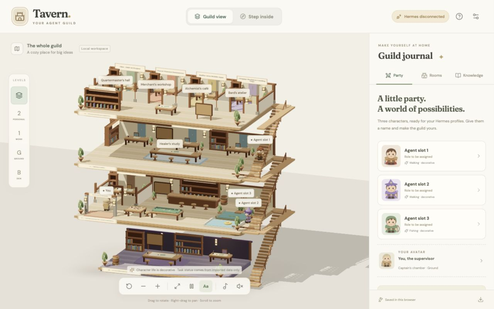

# Tavern · Your agent guild

A working browser 3D guild built with React, React Three Fiber, Three.js, and Drei. All world geometry, character models, original procedural music, and decorative sounds are included in the project. Fonts are bundled; the running app does not fetch third-party assets.



## Run locally

Requirements: Node.js 22.12+ (Node 24 also works) and npm. From this folder:

```sh
npm ci
npm run dev
```

Open **http://127.0.0.1:5173**. Keep the terminal running while using the app. Stop it with Ctrl+C. On macOS, you can also double-click `scripts/start-local.command`, then open that URL.

For a production build and local preview:

```sh
npm run build
npm run preview
```

Open **http://127.0.0.1:4173** and keep the preview process running. The production output is in `dist/`; it can be served by any static HTTP server. This is a browser app, so opening `index.html` directly as a local file is not supported.

## The guild

| Level    | Spaces                                                                                                                  |
| -------- | ----------------------------------------------------------------------------------------------------------------------- |
| Floor 2  | TBA - ERP AI Project, Power Passion Ecommerce, Kaffee Area Mobile Apps, 1Engage Hackaton Landing Page, personal archive |
| Floor 1  | Bithealth company workspace and company records alcove                                                                  |
| Ground   | Entrance, captain's chamber, bar, billiards, board games, archery, training, fishing, swimming pool                     |
| Basement | Shadowy coordination den, brighter when selected                                                                        |

- **Guild view:** drag to rotate, right-drag to pan, scroll/pinch to zoom. Use the level buttons for a single floor or the stacked icon for all floors.
- **Step inside:** WASD/arrow keys to walk, Q/E to turn, drag to look. On mobile, hold the direction buttons. The side staircase connects the floors; level buttons can also jump to a floor.
- Click characters or room labels to open their details. The room list provides the same access without clicking the 3D world.
- Customize all three agent slots: name, adventure archetype, personality, role label, Hermes profile label, and decorative home. The coordinator checkbox moves one of those three characters into the basement.
- Your swordsman supervisor has a captain's chamber and an animated writing/welcoming/chatting routine. Its name is editable in settings.
- Add notes, decisions, and reviewed work in the Knowledge tab or a room inspector. These add books/board entries. Existing furniture and books are decorative props; they are not imported documents.
- Music and office sounds start muted and have separate controls. The pause button pauses character routines. Lightweight rendering is available in settings and is the initial choice on narrow screens.

## Data and Hermes

**Hermes is not connected in this version.** No gateway calls, polling, background tasks, or task dispatch run. Walking, reading, writing, talking, fishing, and breaks are decorative animations and never prove actual agent work.

Project names and the company/personal floor distinction came from you. Detailed project documents have not been imported. Initial character personalities and home assignments are proposed presentation settings. Actual names, profiles, roles, and assignments can be configured later on your VPS.

Character settings, supervisor name, knowledge records, and imported task snapshots are saved in this browser's local storage. They are not shared between browsers or automatically uploaded. **Export guild backup** preserves them; **Settings → Import JSON** can restore that backup after moving to your VPS. Export before clearing browser data or changing the app address.

You can import a dated JSON task snapshot now. It is always labeled **Imported snapshot**, with source and recorded time, and never treated as live gateway activity. See `docs/hermes-integration.md` for the contract and the later gateway adapter boundary. `examples/snapshot.example.json` is an explicitly labeled empty example; it is not loaded by default.

## Upload and run on your VPS

Install Git and Docker Engine with the Compose plugin on the VPS, then:

```sh
git clone https://github.com/alexanderhorison/tavern.git
cd tavern
docker compose up -d --build
docker compose ps
```

You can also upload the project directly, excluding `node_modules`, `dist`, and optional `design`/`output` folders, and run the same Compose command from that directory.

The site is served on the VPS at **127.0.0.1:8080** by default. Point your existing HTTPS reverse proxy at that address. For example, with a Caddy installation on the VPS host, use your own domain in this site block:

```caddyfile
guild.example.com {
    reverse_proxy 127.0.0.1:8080
}
```

If the reverse proxy is itself in Docker, put it and the `tavern` service on the same Docker network and proxy to **tavern:80**. Do not use `127.0.0.1` inside the proxy container to refer to a different container.

To expose a direct VPS port while setting up a proxy, choose the bind address explicitly:

```sh
TAVERN_BIND=0.0.0.0 TAVERN_PORT=8080 docker compose up -d --build
```

That serves this static app at `http://YOUR_VPS_IP:8080`; your VPS firewall must allow that port. A real Hermes adapter with private status should sit behind your own authentication and HTTPS proxy when added later.

**What must stay running on the VPS:** Docker and the `tavern` Nginx container; your reverse proxy for the domain. Node and the development server are only used during the image build and do not need to run in production. The Hermes agent container does not affect this disconnected visual version. A future live adapter will require its own running backend and the Hermes gateway.

After code changes:

```sh
docker compose up -d --build
```

To stop this site:

```sh
docker compose down
```

## Validation

```sh
npm run check
npm test
npm run build
```

The 15 unit checks cover floor assignments, snapshot provenance/validation, knowledge imports, HTTP-preview record creation, and movement boundaries. Browser verification covered floor selection, room/character inspectors, saved character settings, coordinator assignment, knowledge persistence, snapshot import, independent audio mute controls, and desktop/mobile layouts. Keyboard and held mobile controls were checked; walking from Floor 1 up the staircase selected Floor 2.

The production build passes, and npm audit reports no vulnerabilities. Docker Compose configuration validates; the container image was not run locally because the Docker daemon was stopped. Exact frame rate depends on the browser and device; lightweight mode is available for smaller devices.
